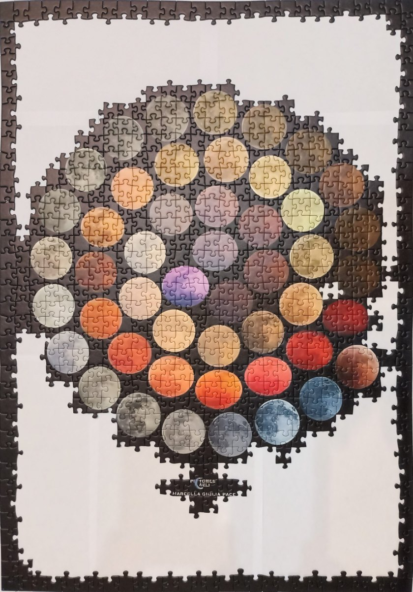
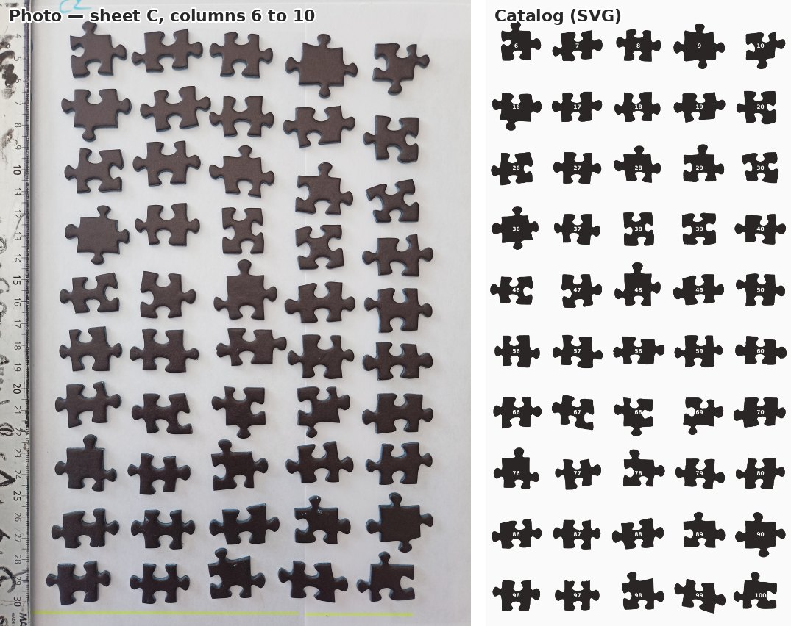
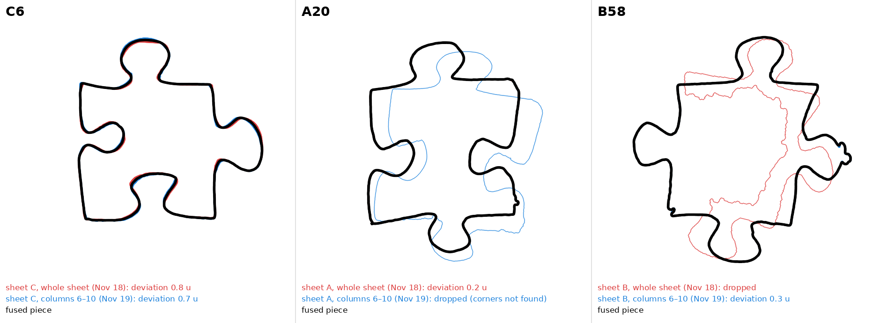
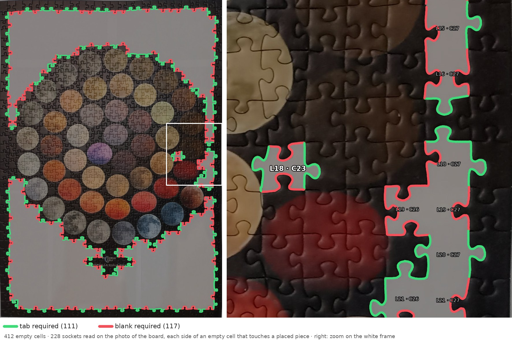
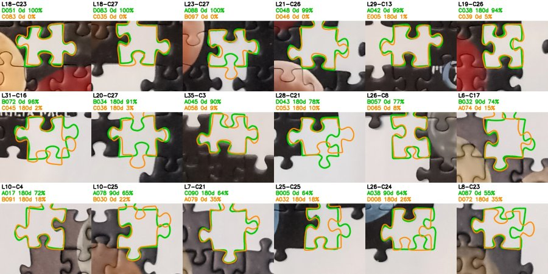
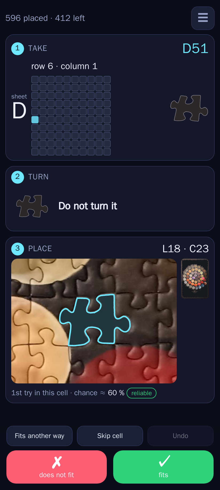
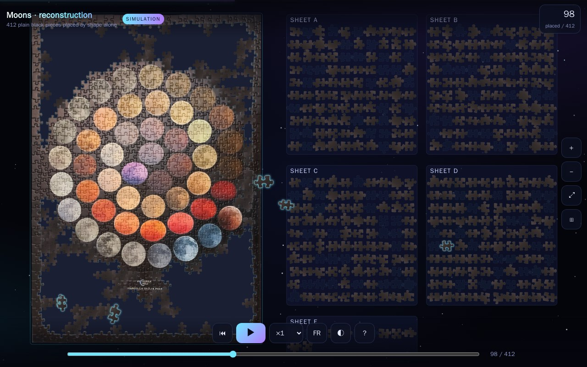
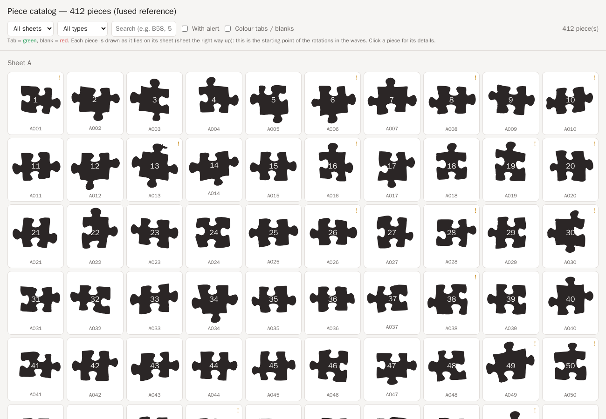

# "Moons" puzzle — finishing 412 black pieces by shape alone

*[Résumé en français plus bas](#en-français).*



A 1,008-piece puzzle (28 × 36): 49 coloured moons on a black background. The frame and the moons are done. What is left is **412 plain black pieces**: no picture to help, only the shape.

This project photographs the pieces and the puzzle, models every outline to a few tenths of a millimetre, and proposes, cell by cell, **which piece to try and which way to turn it**, with a probability. You try, you answer fits / does not fit, and the engine recomputes.

<br clear="right">

## How it works

### 1. Measure every piece on every photo

The pieces are laid out on 5 numbered sheets (A–D: 10 × 10, E: 10 + 2). Each sheet is photographed whole, then in closer half sheets (columns 1–5, columns 6–10); every useful photo of a sheet is kept, including those of a former layout (the manifest says which number is where). On each photo, each piece is segmented, its outline measured at sub-pixel level, its 4 corners found, and it is brought into a common frame. Its 4 sides (tab or blank) are then described by 128-point profiles.



Each catalog piece is drawn **as it lies on its sheet**: this is the starting point of the proposed rotations.

### 2. Fuse the views into one reference catalog

Each piece has 2 or 3 views (photos of different dates, distances and framings). They are overlaid side by side. Agreeing views are averaged, with a weight that depends on the resolution, on the distance to the photo centre (the cardboard edge shows more there) and on the plausibility of the corners. Wrong views are dropped. Before the fusion, the scale of each photo is recalibrated automatically on the pieces it shares with the other photos, even when it varies from one border to the other (photo taken slightly at an angle: up to 5 %). Pieces of another sheet entering the frame are ignored.



Measured on the real sockets of the board, the typical piece ↔ hole deviation (curve distance) goes from 0.83 u (photos of the 18th) or 0.84 u (photos of the 19th) down to **0.81 u with the fusion** (100 u = length of a piece ≈ 2 cm, so about 0.16 mm). Details: [`reports/checks_report.md`](reports/checks_report.md).

### 3. Model the puzzle

The photo of the puzzle is rectified (homography on the frame), then cut into a 28 × 36 grid. The 412 empty cells and the exact outline of each hole are extracted: these are the **sockets**, green when the cell requires a tab, red when it requires a blank.



### 4. Propose, try, start again

For each empty cell at the edge of a placed area, the engine:
- eliminates the pieces whose side types do not match;
- computes the shape deviation of each known side;
- turns everything into probabilities, per cell then globally (a piece can only go to one place);
- measures the **reliability** of each proposal: the computation is run under 9 conditions (catalog of the photos of the 18th, of the 19th or of all × 3 settings of the hole edges) and counts how often the same piece comes first. Probabilities alone are too optimistic; a wave only keeps the proposals stable in at least 8 conditions out of 9.

A **wave** lists the best proposals, with a virtual fitting:



| # | Cell | Known sides | Piece | Rotation from the sheet | Reliability | Engine % |
|---|---|---|---|---|---|---|
| 1 | L18-C23 | 4 | **D051** | no turn | 9/9 | 100 % |
| 2 | L18-C27 | 3 | **D083** | ¼ turn anticlockwise | 9/9 | 99 % |
| 3 | L21-C26 | 3 | **C048** | no turn | 9/9 | 89 % |

Full wave: [`reports/wave_1.md`](reports/wave_1.md). Every placed piece creates new sockets for its neighbours, and cells unlock step by step.

### 5. The live workshop

Waves become a continuous loop on a phone at the table: the **workshop** shows one piece at a time — where to take it, how to turn it, where to place it — and the user answers *fits* or *does not fit*. Every answer is written to an append-only journal on the server; the engine replays it, recomputes the 9 reliability conditions incrementally (≈ 1 s) and proposes the next piece, calibrating its "chance" on the real answers. Every ≈ 30 placements, a new photo of the puzzle sent from the phone is checked and turned into a new board model by the server. Design: [`docs/ATELIER.md`](docs/ATELIER.md).



## Demo: the animated reconstruction

[`demo/index.html`](demo/index.html) plays a complete **simulated** reconstruction: each piece leaves its sheet and flies once to its cell, slowly at first, then in a cascade, until the puzzle is complete — on a cleaned photo of the real puzzle, in English or French. It is a showcase: it assumes the engine corrects itself to the end; the ◐ button colours each piece by how well it actually fits its neighbours, which shows how far the simulation can be trusted. The real reconstruction moves forward through trials on the real puzzle, which correct the engine along the way.



## Explore

- **Interactive catalog**: [`catalog/catalog.html`](catalog/catalog.html), a self-contained file to open in a browser. Filter by sheet and type, search a piece; each card shows its sides and the fused photos.
- **A piece**: `catalog/<sheet>/<ID>.svg`; **a sheet**: `catalog/sheet_<X>.svg`; **the puzzle**: `board/board.svg`.
- **Checks**: [`reports/checks_report.md`](reports/checks_report.md) (C1–C9) and the check sheets [`reports/measurements/`](reports/measurements/): on each photo, each piece is marked green if it agrees with the reference, red if the view is dropped.



## Layout

```
photos/        inputs: sheets/ (one view per photo), board/, manifest.json (inventory, single source)
src/           Python code (see below)
data/          models: pieces.json (reference catalog), board.json (board), proposals.json,
               placements.json (trials), params.json, corrections.json; measurements/ (intermediate)
catalog/       SVG of the pieces and sheets, catalog.html
board/         board.svg (model of the puzzle) and its background
reports/       checks_report.md, waves (wave_N.md + fitting), check sheets
demo/          public demo (index.html, demo.js, demo.css; demo_data.js + board_clean.jpg generated)
server/        web server of the demo and the workshop (Starlette): routes, login, journal, live engine
web/atelier/   workshop interface (phone)
tests/         engine, journal and HTTP tests
docs/          CONVENTIONS.md (units, frames, identifiers), ATELIER.md (workshop design), SIMULATION.md, images/
Dockerfile     container images (pipeline, server); docker-compose.yml (production), docker-compose.dev.yml (local)
scripts/       pipeline.sh (pipeline in its container), screenshots.sh (README screenshots)
```

| Stage | Script | Output |
|---|---|---|
| Measurement | `measure_sheets.py` (+ `segmentation.py`, `geometry.py`) | `data/measurements/`: one view per piece and per photo |
| Fusion | `fusion.py` | `data/pieces.json`: reference catalog; check sheets `reports/measurements/` |
| Catalog | `export_svg.py`, `build_html.py` | `catalog/` |
| Board | `board_model.py` | `data/board.json`, sockets, `board/board.svg` |
| Proposals | `solve.py`, `reliability.py`, `wave.py` (+ `fit_view.py`, `match.py`) | `data/proposals.json` (with reliability), `reports/wave_N.md` / `.json` |
| Simulation and demo | `simulation.py`, `demo_export.py` ([`docs/SIMULATION.md`](docs/SIMULATION.md)) | `data/simulation/simulation.json`, `demo/demo_data.js` |
| Checks | `evaluation.py`, `checks.py` | `reports/checks_report.md` |
| Workshop | `model_export.py`, `live.py`, `journal.py`, `server/` | `data/model/`, live proposals, journal |
| Illustrations | `illustrations.py`; screenshots `scripts/screenshots.sh` (headless browser) | `docs/images/` |

## Run

Everything runs in Docker, from a Unix shell at the root of the repository; nothing is installed on the host. The pipeline image is Debian 12 with the scientific stack from Debian packages.

```bash
sh scripts/pipeline.sh all          # rebuild everything (≈ 5 min) — to do after a clone
sh scripts/pipeline.sh catalog      # after new sheet photos (declared in photos/manifest.json)
sh scripts/pipeline.sh board        # after a new photo of the puzzle
sh scripts/pipeline.sh wave 2       # after recording trials in data/placements.json
sh scripts/pipeline.sh checks       # evaluation + check report
sh scripts/pipeline.sh demo         # full simulation + demo data (≈ 5 min)
sh scripts/pipeline.sh model        # model of the workshop (catalogs per photo date + version)
sh scripts/pipeline.sh test         # engine and journal tests
sh scripts/pipeline.sh --script src/montage.py A001,B018 out.jpg   # any other script
```

Large binary intermediates (`*.npz`, `*.npy`, rectified board) are not versioned: `pipeline.sh all` recreates them.

**Workshop and demo locally** (after `pipeline.sh all` and `pipeline.sh model`):

```bash
echo PUZZLE_DEV_AUTOLOGIN=1 > .env                              # local review only: no login
docker compose -f docker-compose.dev.yml up -d --build          # http://localhost:8080 (demo), /atelier/ (workshop)
docker run --rm puzzle-server:dev python3 -m unittest tests.test_server -v     # HTTP tests
```

**Production**: `docker-compose.yml` runs the same image read-only, behind a Traefik reverse proxy and Cloudflare; copy
`.env.example` to `.env` and fill it in (domain, password hash from `python3 -m server.auth hash`, data directory).
The journal of the answers lives in that data directory, append only.

## Conventions

- **Pieces**: sheet + number by rows (`B058` = sheet B, 6th row, 8th column; E: `E001`–`E010` on the 1st row, `E011`–`E012` below `E001`–`E002`).
- **Cells**: `L(line)-C(column)` from the top-left corner of the puzzle **seen in reading direction** (text "Marcella Giulia Pace" at the bottom), frame included.
- **Rotations**: to apply to the piece as it lies on its sheet (sheet the right way up), as in the catalog.
- **Unit u**: 100 u = median long side of the core of a piece (typical piece: 90 × 100 u).

All of them, with the frames and rotations of the engine: [`docs/CONVENTIONS.md`](docs/CONVENTIONS.md).

## Status

- Reference catalog: 412 pieces, 2 or 3 views each, same process for every sheet; all checks OK.
- Puzzle: 28 × 36 confirmed by counting the edges (1,008 pieces, the box says "1000"). **596 pieces placed, 412 empty cells** (recounted cell by cell: [`reports/board_count.md`](reports/board_count.md)): 4 pieces were missing, **found in a cupboard** thanks to this count and added to sheet E (E009–E012). 412 pieces for 412 holes.
- Wave 1: 18 proposals, all stable under the 9 conditions; they are the first proposals of the workshop.
- Workshop and public demo: built and tested; first real use to come.
- Full simulation: works, but credible over ≈ 25 placements only with the current precision ([`docs/SIMULATION.md`](docs/SIMULATION.md)). Error budget ([`reports/accuracy.md`](reports/accuracy.md)): the comparison method was the weak link, not the photos (curve distance instead of paired points, outline bias of the catalog corrected: wrong pieces as good as the true one per hole 4.7 → 0.1). Beyond the holes measured on the board, a new photo of the puzzle every ≈ 30 placements is the lever.

## Credits and license

- The puzzle artwork (moons) is by **Marcella Giulia Pace** (*Pictores Caeli*); it appears on the photos, the README images and the demo only to show what the project works on. It is not covered by the license below.
- Photos of the pieces and of the puzzle: taken for this project and provided to reproduce its results; as they show the artwork, they are not covered by the license either.
- Code and documentation: [MIT](LICENSE).

## En français

Un puzzle de 1 008 pièces (28 × 36) : 49 lunes colorées sur fond noir. Restent **412 pièces noires unies**, à placer par la forme seule. Le projet photographie les pièces et le puzzle, modélise chaque contour au dixième de millimètre, et propose case par case **quelle pièce essayer et dans quel sens**. On essaie, on répond « rentre » ou « ne rentre pas », et le moteur recalcule. L'**atelier de pose** sur téléphone propose une pièce à la fois et apprend de chaque réponse ([`docs/ATELIER.md`](docs/ATELIER.md)) ; une [démo animée](demo/index.html), en français ou en anglais, montre la reconstitution complète.
