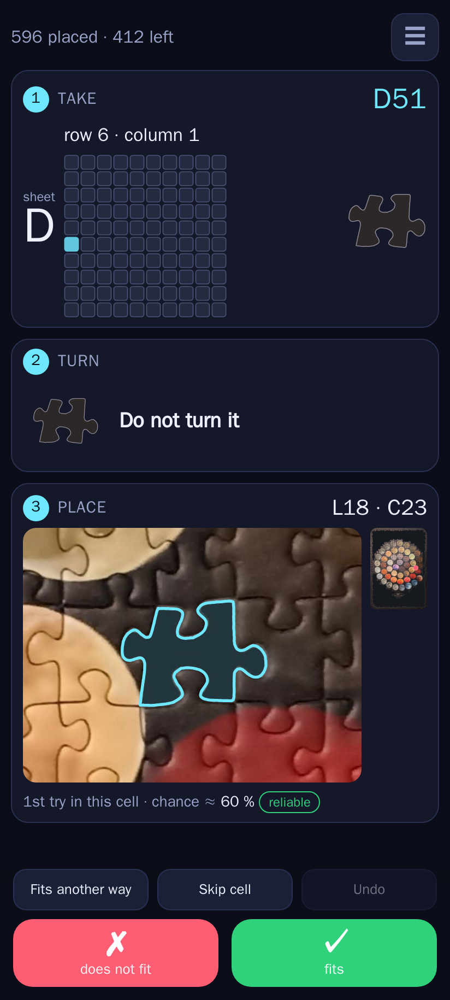

# Live placement workshop ("atelier") and public demo — design

"Atelier" (workshop) is the name of the placement app: a phone app used at the table, one piece at a time. Its
interface is in French by default, English available. The public demo is a separate, static page served by the same
server.

## 0. Decisions

| Topic | Decision |
|---|---|
| Demo | Public: only the **direct path** (412 flights to the assumed final state), without the search steps. Clean puzzle background. Bilingual EN / FR. |
| Real placement | **Workshop** behind a login, designed to be practical at the table: one cell, its candidates one by one, answers ✓ / ✗. No "doubt" (pieces are never forced). "Skip" possible without creating a dead end. |
| Where | One Docker container: `/` = demo, `/atelier/` = installable app on the phone. |
| Computation | The server is enough: deterministic Python engine, self-adjusted by the answers; no external service. |
| Cache | Designed so that a stale page or script cannot be served (§ 8). |
| Login | One account (the person who places the pieces). Password + long-lived cookie + passkey (fingerprint). |
| Wave 1 | Its 18 proposals are the starting point of the workshop (and a non-regression test). |
| Runtime | Everything in containers (pipeline, server, tests). |

## 1. Overview

```
Workstation (git repository, Docker)        Server (Docker, reverse proxy)                Phone
────────────────────────────────────        ──────────────────────────────                ─────
photos → pipeline → model     ──deploy──▶   image "puzzle" (model frozen inside)
  (catalog, board, params)                   ├─ /            static demo (public)    ◀── shared link
                                             ├─ /atelier/    placement app (login)   ◀── installed app
                                             ├─ /api/…       live engine
                                             └─ volume: journal, photos, recalibrated models, backups
data/live/ ◀──── sync (read only) ────────── journal.jsonl
  journal.jsonl → placements.json (derived)
```

Three rules that do not move:
1. **The server journal is the only truth about the real puzzle.** `data/placements.json` is derived from it (same format as before the workshop: every script keeps working).
2. **The simulation never writes to the journal nor to `placements.json`.**
3. **The state of the engine is a pure function of (model, journal)**: at start-up, the journal is replayed. Nothing else to save, nothing that can diverge.

## 2. Public demo

**Sequence** (≈ 60–90 s at normal speed, adjustable):
1. *Opening*: the puzzle as it is (the moons, 596 pieces) on a clean background; the 5 sheets of black pieces beside it.
2. *Flights*: each piece lifts from its sheet, turns while flying (arc trajectory), and snaps into its cell with a slight glow. The tempo accelerates: the first ones one by one, then in a cascade.
3. *Finale*: last piece, zoom out on the complete puzzle, "412 / 412", credit of the artwork (Marcella Giulia Pace).
4. Discreet controls: play / pause, speed, scrubber, replay, EN / FR. Works by touch on a phone.

**Clean background**:
- rectified photo **cropped at the exact outer edge** of the puzzle (no white margin);
- **paper of the holes repainted** in puzzle black (mask "empty paper" computed by `board_model`): no white slivers;
- **pieces at their real position**: one global least-squares fit on the real holes and on each other (`demo_fit.py`);
- pieces in **real black** with a fine edge highlight: the finished board must look like a real puzzle.

**Honesty**: a mention "reconstruction computed by the engine"; really confirmed placements appear as such. The demo is regenerated from the real state of the moment: the further the workshop goes, the truer it gets. When the puzzle is finished: replay **the real timeline** of the journal.

**Technique**: static files without dependency, data generated by the pipeline (≈ 1 MB), content-hashed file names (§ 8). No API call.

## 3. Workshop: how it is used

Unit of work = **one cell** and its **ranked candidates**. For each candidate: where to take the piece, how to turn it, where to place it.

| # | Situation | What happens |
|---|---|---|
| U1 | Open the app | State loaded (loader if the server is starting, § 5.4) → the current proposal, identical to the one left last time. |
| U2 | **✓ fits** (in the indicated orientation) | Placement recorded; its edges become sockets for its neighbours; next cell. |
| U3 | **Fits, but in another orientation** | Small button → 3 drawings of the piece turned → tap the right one. Recorded with the real rotation (essential for the neighbours). Warning if the computed fit is bad. |
| U4 | **✗ does not fit in any orientation** | Piece excluded from this cell (4 rotations). Next candidate **at once**. Banner "↩ Put C47 back: sheet C, row 4, col. 7, **this way up**" (thumbnail in its original orientation). |
| U5 | No credible candidate left in the cell | Clear message; the cell **sleeps** until one of its neighbours is placed (new edges → new candidates); next cell. |
| U6 | **Skip the cell** | The cell comes back when a neighbour changes or after 10 other answers. The pieces stay available everywhere. No permanent dead end. |
| U7 | **Undo** | Undoes the last action (then the previous one, etc.). For an undone ✓: "remove C47 from L18-C23 and put it back on sheet C, row 4, col. 7, this way up". |
| U8 | Double tap, page left open, two phones | Each answer carries the identifier of the displayed proposal: a stale answer is refused, the page refreshes. Consistent even with two people. |
| U9 | Network lost while sending | "Answer not recorded — retry". Resending is safe (unique event identifier: never counted twice). **No offline queue**: nothing is placed on a hypothesis the server has not validated. |
| U10 | No reliable proposal left anywhere | Continue with proposals marked "weak", or take a recalibration photo (U11). |
| U11 | Recalibration photo (reminder every ≈ 30 placements since the last photo taken into account) | Button "Send a photo of the puzzle" (instructions shown: from the front, diffuse light) → **processed automatically by the server** (L6, ≈ 2–3 min); the workshop keeps going meanwhile, a banner shows the stage, then "photo taken into account" or the reason of a rejection (frame not visible, blurred, cells that differ from the answers — named —, holes less sharp than before) with what to do. One photo at a time. |
| U12 | Statistics | Placed / left, ✓ / ✗ of the day, success by reliability level (live calibration). |
| U13 | Puzzle finished | End screen; complete journal; "real timeline" demo. |

## 4. Workshop screen (phone, portrait, one hand)



```
┌──────────────────────────────┐
│ 37 placed · 375 left       ☰ │  bar: progress, menu (stats, photo, theme, language)
├──────────────────────────────┤
│ ↩ Put C47 back: C · R4 · C7  │  put-back banner (after a ✗)
├──────────────────────────────┤
│ 1 TAKE                   C47 │  piece named as on the sheets,
│  sheet C  row 4 · column 7   │  mini sheet: slot lit, slots already emptied greyed
│  [mini sheet]   [thumbnail]  │
├──────────────────────────────┤
│ 2 TURN     ¼ turn clockwise  │  animated arrow: from the sheet orientation to the placement orientation
├──────────────────────────────┤
│ 3 PLACE            L18 · C23 │  zoom on the cell and its neighbours, hole + piece overlaid,
│  [board zoom] [locator]      │  small full board with the area located
│ 1st try · chance ≈ 70 %      │  chance = calibrated rate (not the raw engine %)
├──────────────────────────────┤
│ fits another way · skip · undo│ secondary actions, small
│ [   ✗   ]        [   ✓   ]   │  two big buttons at the bottom, within thumb reach
└──────────────────────────────┘
```

- Dark theme by default, light theme from the menu (remembered on the phone). Short texts, no jargon ("chance", not "Sinkhorn").
- The piece is named as written on the sheets (`D51`, not `D051`): "sheet D · row 6 · column 1" alone reads as "D61".
- Nothing moves under the finger during a computation: buttons disabled + indicator, an answer is never applied to another card.

<br clear="right">

## 5. Live engine

### 5.1 Choice of the proposal
- Cells ranked by **calibrated chance** of their first candidate (stability over the 9 conditions, engine %, absolute quality → observed success rate, § 5.2).
- Close chances: **the cell closest to the previous one** (staying in the same area of the puzzle), then the one that unlocks the most neighbours.
- Candidates of a cell: shown as long as their chance exceeds a threshold and their quality is not "poor" (≈ 3 to 5 per cell); then the cell sleeps (U5).

### 5.2 Self-adjustment
| Signal | Immediate effect |
|---|---|
| ✓ | new real sockets for the neighbours (the strongest effect) |
| ✗ | exclusion (cell, piece); probabilities redistributed |
| all | **calibration**: success rate per reliability level (cautious prior, corrected by each answer) → ranking and displayed "chance" |
| recalibration photo | new board model: the pieces placed since the last photo become measured holes (L6) |

Calibration buckets: A = the wave rule (stability ≥ 8/9, ≥ 50 % in the cell, ≥ 20 % global, quality not poor),
B = stability ≥ 1/2, C = other; priors 60 / 30 / 10 % weighing 4 answers, then corrected by every real answer. A
candidate is proposed in normal mode if its chance ≥ 12 %, its quality is not poor and its cell has had fewer than 5 ✗;
after a ✗ the workshop stays on the same cell while such a candidate exists, otherwise it moves on.

### 5.3 Computation time
- 9 engines in memory (one per reliability condition), updated incrementally: only the cells next to the last placement are rescored. **One answer ≈ 1–3 s.**
- The live engine gives exactly the batch results (candidates, σ, stability) for the same placements: tested.
- Start-up: model, 3 catalogs, 9 engines, replay of the journal; the scores of the board sockets are cached with the model (≈ 25 s instead of ≈ 4 min).

### 5.4 Loader
- Start-up: waiting screen with the real stages ("catalog…", "reliability 4 / 9…", "replaying the journal…") and a progress bar provided by the server.
- Short computation: buttons disabled, small indicator.
- New app version: automatic reload, only between two answers (§ 8).

## 6. Data and persistence

**On the server** (host directory mounted as a volume):
- `journal.jsonl`: one event per line, **append only**, written to disk synchronously. Fields: number, timestamp, unique identifier (sent by the page: resend without duplicate), type (`fits`, `fits_other_rotation`, `does_not_fit`, `skip`, `undo`, `recalibration_photo`, `recalibration`, `recalibration_failed`), complete proposal (cell, piece, rotation, rank, stability, %, chance), model version, app version, device.
- `photos/`: recalibration photos sent from the workshop (JPEG checked, ≤ 25 MB); `recalibration/<photo>/`: processing (`status.json`, `expected.json`) and, when accepted, the new model (`model/`, loaded by the workshop and named in the journal event `recalibration`).
- `backups/`: daily copy of the journal (30 days).
- `auth/`: sessions and passkeys as small JSON files (atomic writes); the password hash comes from the environment.

**In the image** (frozen, reproducible): the model (catalog, board, parameters, score cache) with its version identifier (content hash), the code, the demo.

**On the workstation**: the journal is fetched read only into `data/live/` and `data/placements.json` is derived from it (`journal.py`).

## 7. Life cycle

| # | Event | Sequence |
|---|---|---|
| L1 | First start | Password hash in `.env` → login → passkey → "install app" → rehearsal with a test journal → journal archived → wave 1 for real. |
| L2 | Daily use | U1–U13. |
| L3 | The container restarts | `restart: unless-stopped`, health check; journal replay; the page shows the loader then **the same proposal** (everything derives from the journal, including skipped or sleeping cells). No loss: every accepted answer is already on disk. |
| L4 | Code update (interface fix) | Journal copy, new image, journal untouched; the page sees the new version and reloads between two answers. |
| L5 | New model (catalog fix, parameters) | Prepared and checked on the workstation: **replay of the journal on the new model** (do all ✓ placements stay consistent? which proposals change?) → new image. |
| L6 | Recalibration photo | **Automatic** (`src/recalibrate.py` in its own process, launched by `server/workshop.py`): photo reduced to ≤ 5000 px; frame; orientation chosen by agreement with the journal; sharpness (edge width ≤ 1.95 u); empty cells = `params.json` `empty_cells` minus the placements recorded (any difference rejects the photo and is named); sockets not worse than the current model; new model directory in the volume (catalog copied, new board, score cache); the workshop switches to it and writes `recalibration` in the journal (`recalibration_failed` with the reason otherwise, `interrupted` after a restart). The placements visible on the photo become measured holes: they are no longer fitted from the catalog (`live.place`, `solve.effective_sockets`). On restart, the last `recalibration` of the journal gives the model. Measured: ≈ 140 s, ≈ 1.4 GiB at the peak with the server running. |
| L7 | Rollback | Previous image; journal compatible (versioned format, append only). |
| L8 | End of the puzzle | U13; final journal versioned; "real timeline" demo. |

## 8. Cache and updates

| Item | Rule |
|---|---|
| Service worker | **None** (useless offline; installation from the browser menu works without it). |
| HTML pages | `Cache-Control: no-cache`: always revalidated. |
| JS, CSS, demo data | **Content-hashed** name generated at build (`app.3f9a1c.js`), `max-age` 1 year `immutable`: a new version has another name, an old file is never served. |
| API | `Cache-Control: no-store`; 401 without redirect. |
| Version | Every API response carries the app and model versions; the page compares with its own and reloads if needed (between two answers). |
| CDN in front | Must respect the origin headers and not cache the HTML (e.g. Cloudflare: Browser Cache TTL "Respect Existing Headers", a "Bypass cache" rule for the host, no script injection such as Rocket Loader, which the CSP would block). |

## 9. Login and security

- One account. Password hashed (scrypt) in the environment; passkey (WebAuthn, fingerprint, ES256 / RS256) registered after the first login; cookie `HttpOnly`, `Secure`, `SameSite=Strict`, 1 year, extended on use; 5 attempts / 15 min per address. `PUZZLE_DEV_AUTOLOGIN=1` skips the login in local development only (refused with secure cookies).
- Public demo read only; workshop and API behind the login; POST accepted from the same origin only.
- Container without root, read-only file system (except the volume and `/tmp`), `cap_drop: ALL`, bounded memory and processes; strict CSP, no inline script; photo upload limited (JPEG, ≤ 25 MB). In production, only the reverse proxy's addresses are accepted (Cloudflare ranges in `docker-compose.yml`).

## 10. Logs and diagnostics

- **Business journal** (`journal.jsonl`): everything that happened at the puzzle.
- **Technical log**: container standard output as JSON lines (requests, computation times, start-up stages, errors with traceback), Docker rotation (10 MB × 3); never a password nor a cookie. Browser errors are sent back to the server (rate limited) and written to the same place.
- `/api/health` (health check), `/api/diag` (logged in: versions, memory, computation times, calibration, recalibration).

## 11. Local development and tests

- Same image locally (`docker compose -f docker-compose.dev.yml up`, http://localhost:8080), development journal in a folder ignored by git.
- Tests (in the containers): `sh scripts/pipeline.sh test` (engine, journal, recalibration) and the HTTP tests in the server image:
  - **non-regression**: at start, the workshop proposes exactly wave 1; state built placement by placement = state rebuilt from `placements.json`;
  - journal: replay, chained undo, resend of the same event, stale answer, skipped / sleeping cells;
  - recalibration: reference photo, turned photo, blurred photo, a recorded placement missing from the photo;
  - HTTP: login, 401, cache headers, limits, photo flow.

## 12. Language

- **English**: code (names, comments, docstrings), technical messages, file names, JSON keys, generated reports, documentation.
- **French and English**: demo (browser language, EN / FR switch), workshop (French by default, switch). The journal stores codes, never sentences.

## 13. Risks

| Risk | Counter-measure |
|---|---|
| Wrong ✓ (piece badly placed) corrupting the neighbours | warning if the computed fit is bad; undo; recalibration photo |
| Piece put back the wrong way on its sheet after ✗ | put-back banner with thumbnail; "fits another way" catches the case |
| Accumulating error (placements drawn from the catalog) | recalibration photo every ≈ 30 placements (L6) |
| Old version served by a cache | § 8 |
| Loss of the journal | append only + synchronous write + daily backups + copies on the workstation |
| Workstation / server divergence | same code, same image; "wave 1" test at start-up |

## 14. Not implemented yet

- σ / shadow-bias re-estimation from the confirmed placements (after ≥ 10 ✓).
- "Real timeline" demo replayed from the journal (L8).
