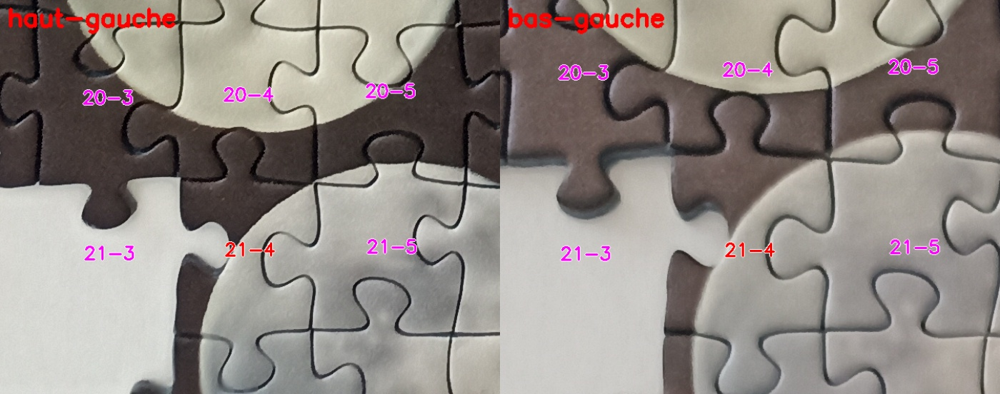

# Count of the placed pieces — 2026-11-19

**596 placed pieces, 412 empty cells** out of 28 × 36 = 1,008 (size confirmed by counting the edges).
Sheets A–E held 408 pieces: **4 pieces were missing**. They were found in a cupboard the same day and added to sheet E (E009–E012): 412 pieces for 412 holes.

## Method

1. The 4 quarter photos of the board (`photos/board/board_2026-11-19_*`) are registered onto the rectified reference photo (SIFT + RANSAC homography, median error ≈ 1.5 u), which gives a sharper view of each cell than the reference.
2. Each cell was classified automatically (empty / placed) on the quarter where it is the most centred, then **every cell was re-read by eye**: one red dot per empty cell of the model, on the photos of the 19th, in 6 areas. A red dot on a piece, or a hole without a dot, signals an error.
3. Result: a single error, **L21-C4**, counted empty although a piece is placed there (dark edge + a piece of silver moon; the paper of L21-C3 spills into the centre of the cell). Fixed in `data/params.json` → `verified_filled_cells`.

Borderline but really empty cells (checked): L14-C2, L21-C27. Between the 18th and the 19th, no piece moved nor was placed.

Wave 1 is unchanged (L21-C4 was already excluded from it).

## Placed pieces per line

| Line | Placed | Line | Placed | Line | Placed |
|---|---|---|---|---|---|
| L1 | 28 | L13 | 26 | L25 | 21 |
| L2 | 3 | L14 | 26 | L26 | 17 |
| L3 | 2 | L15 | 27 | L27 | 15 |
| L4 | 2 | L16 | 27 | L28 | 9 |
| L5 | 2 | L17 | 28 | L29 | 4 |
| L6 | 8 | L18 | 26 | L30 | 8 |
| L7 | 15 | L19 | 26 | L31 | 4 |
| L8 | 18 | L20 | 27 | L32 | 2 |
| L9 | 20 | L21 | 24 | L33 | 2 |
| L10 | 22 | L22 | 26 | L34 | 2 |
| L11 | 24 | L23 | 25 | L35 | 3 |
| L12 | 26 | L24 | 23 | L36 | 28 |

Lines easy to check on the puzzle: L2 and L35 (3 pieces: the 2 of the frame + a piece hooked in a corner, L2-C27 and L35-C2), L3–L5 and L32–L34 (frame only: 2).
